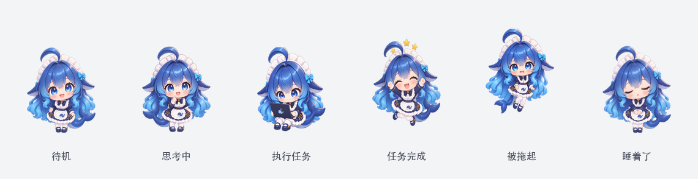

# Token 面板 + 花费 + 桌面宠物

一套本地小工具，只读磁盘上的日志，不联网、不改任何客户端。三件事：

1. **用量面板** —— 把 **DeepSeek（WorkBuddy）+ ChatGPT（桌面版）+ Claude Code**
   消耗的 token 按天统计成网页报告，柱状图按来源分色
2. **花费** —— Claude Code 在本机一共花了多少钱（读 `~/.claude/projects` 的日志、
   按模型单价折算，覆盖本机能读到的全部历史），命令行和桌宠卡片共用同一个口径
3. **桌面宠物** —— 一只用透明窗口浮在桌面上的小鲸鱼娘，会**看着你干活**：
   你让她工作时她坐着敲电脑、思考时歪头、任务完成时跳起来、没动静了会睡着



她本人在桌面上长这样（截图于 2026-09-24，头顶那三个点是"正在思考"的状态提示）：


> 顺带说明：**这不是 WorkBuddy 官方功能**，是一个独立的本地小工具，
> 只读 WorkBuddy 写在磁盘上的记录文件，不改它、也不联网。
>
> 命名说明：ChatGPT 桌面版的数据目录是 `~/.codex`，所以代码里沿用了 `codex`
> 这个名字（`CodexSource`、`--source codex`、`SRC_CODEX`）；
> **页面上统一显示为 ChatGPT**，跟目录名脱钩，避免看的人以为装了两个东西。

---

## 30 秒上手

| 想干什么 | 怎么做 |
|---|---|
| 看一共用了多少 token（DeepSeek + ChatGPT） | 双击 **`查看用量.command`**（或 `python3 usage_stats.py --open`） |
| 查 Claude Code 一共花了多少钱 | `python3 claude_cost.py status`，或直接看桌宠顶部的「已花费」 |
| 让鲸鱼娘浮在桌面上 | 双击 **`启动桌面宠物.command`** —— 首次会自动编译窗口，约 10 秒 |
| 只想看看她的动画 | 双击 **`pet.html`** —— 不用装任何东西，也不需要 WorkBuddy |
| **Windows 11 上用** | 见 [`windows/`](windows/README.md)：`cd windows && npm install && npm start`，或 `npm run dist` 打安装包 |

环境要求：**macOS + Python 3**（统计与状态服务只用标准库）。
只有编译桌面窗口那一步才需要 Swift 命令行工具：`xcode-select --install`。

---

## 它解决什么问题

WorkBuddy 客户端**只显示积分（credits），不显示 token 数**；
ChatGPT 桌面版那边也只有额度进度条，看不到具体 token。
但你想知道"一共用了多少 token"的时候，两边都答不了。
Claude Code 那边更微妙：`/cost` 只算当前会话，想看**累计花了多少**得自己翻日志。

好在这件事的原始数据一直在本地：每次 LLM 调用的 token 明细，
分别写在 `~/.workbuddy/projects/<项目>/<会话>.jsonl`、
`~/.codex/sessions/**/rollout-*.jsonl` 和 `~/.claude/projects/**/*.jsonl` 里。
所以完全可以自己算出来 —— 这个项目就是把这件事做成能看的东西。

---

## 用量面板

> 面板截图就不放了 —— 它上面是真实用量数字，公开仓库里没必要晒。
> 你自己双击根目录的 `查看用量.command` 就能看到。

面板统计**两个来源**，柱状图按来源分色堆叠：

| 来源 | 读哪里 | 颜色 |
|---|---|---|
| DeepSeek（WorkBuddy） | `~/.workbuddy/projects/<项目>/<会话>.jsonl` | 蓝 `#2b6cff` |
| ChatGPT（桌面版） | `~/.codex/sessions/<年>/<月>/<日>/rollout-*.jsonl` | 紫 `#7c3aed` |

### 日期范围管的是整页

页头那个按钮点开是**日历，自己点起始日和结束日**（也带「近 7 天 / 近 30 天 /
本月 / 全部」四个预设）。没有数据的日子是灰的，点不动。

范围一选，**整页的数字都跟着变** —— 卡片、按来源、按模型、按天明细、按项目、
会话排行，全部重算。想看"9 月上半月花了多少、哪个会话最烧"，圈一下就行。

选好的范围会写进地址栏的 `#` 里，所以点「重新统计」（它会重载页面）之后
不会打回"全部"。关掉页面重新双击打开时又回到"全部"——那才是干净的默认值。

### 「工作日」开关

预设那一排最后有个 **工作日** 开关，打开后只统计工作日，可以和范围叠加
（比如「本月 + 工作日」）。它按**国务院办公厅的放假安排**算，不是简单地
跳过周末：

- 法定假日不算（2026 年中秋 9/25–9/27、国庆 10/1–10/7）
- **调休上班的周末算工作日**（2026 年 9/20 周日、10/10 周六上班）

打开之后**哪些天被算进去是看得见的**：按钮上直接写"全部 33 天 · 工作日 20 天"，
日历里不计入的日子会被划掉（9/25 周五会划掉、9/20 周日不会）。

假期表在 `usage_stats.py` 顶部的 `HOLIDAYS_2026` / `MAKEUP_WORKDAYS`，
已逐条与国办通知中标注的星期核对过。**每年 11 月左右会发下一年度的通知，
到期要手工补**；没补之前当年会退化成"周一~周五算工作日"。

「连续天数」是按**自然日**算相邻的，不是按筛出来的行——所以开了工作日之后
周一到周五算连续，跨周末不算。

为什么能做到秒变：报告生成时会把**足够细的数据包**内联进页面
（每天每来源的 token / 调用 / 输入 / 输出，模型、项目、会话的按天稀疏表，
以及已经切好的连续对话分段），换范围是纯前端重算 —— 不联网、不依赖本地服务，
双击 html 打开就能用。整包 20KB 出头。

柱顶的数字**只在放得下的时候才标**（比如一周 7 根）。33 天那种密度下每列只有
22.7px，而「9454万」这种标签要 36px —— 放不下就一个都不标，
**不抽稀（看着像漏数据）、也不竖排（得歪着脖子看）**。
密集的时候要看准确数字：**点那根柱子**，图下面会出一条横着的读数
（日期 / 合计 / 各来源拆分明细 / 调用次数），再点一下取消。鼠标悬停也能看。
放不放得下是按**实测字宽**判断的，不是写死的列数阈值。

图表的量程按**当前范围自己的峰值**换算，所以圈到一周时小柱子也看得清；
量程写在左下角，极小被抬到 4px 的柱子也会标出来，不会让你对着柱子猜大小。

```bash
python3 usage_stats.py                    # 全部历史（默认，两个来源都算）
python3 usage_stats.py --month 2026-10    # 只看某个月
python3 usage_stats.py --days 7           # 最近 7 天
python3 usage_stats.py --since 2026-09-01 # 从某天起
python3 usage_stats.py --source codex     # 只看某一个来源（可重复给）
python3 usage_stats.py --open             # 生成后自动打开
```

macOS 上也可以**双击 `查看用量.command`**。

### 口径

`累计 Token = sum(total_tokens) = 输入 + 输出`，和两边的接口账单口径一致。

这个口径是**对照 ChatGPT 本地记录验证过**的：

```json
// ~/.codex/sessions/**/rollout-*.jsonl 里的 token_usage_record
{"input_tokens": 26960, "cached_input_tokens": 16128, "output_tokens": 370,
 "total_tokens": 27330}          // 26960 + 370 = 27330 —— 缓存部分不额外剔除
```

所以两边算出来的数字**可以直接横向比**。

两个来源各有一个坑，代码里都处理了：

- **ChatGPT**：一个会话被「续写」会新开一个 rollout 文件并**整段重放历史**，
  必须按 `response_id` 去重，否则同一个响应被计两次。
- **WorkBuddy**：按 `(时间戳, 输入, 输出, 模型)` 四元组防重放。

另外「最长连续对话」不是会话首尾时差 —— 那样 ChatGPT 的续写会话能算出 8 天来。
现在是按空档切段：**断开超过 2 小时就不算同一段**。

---

## 卡片上的两个数字

<p align="center">
  
</p>

窗口只有 160×200，卡片一侧一行：顶部是**已花费**，底部是**今日全部工具的 Token**。
配色取自立绘本身（暖白底 + 深蓝字），和角色同色系。

### 为什么 Token 很多、钱很少？

两个数字**口径不同，不能互相验证，也不该相加**：

| | 已花费（顶部） | 今日 Token（底部） |
|---|---|---|
| 算谁 | 只有 Claude Code | WorkBuddy + ChatGPT + Claude Code |
| 时间 | 本机能读到的**全部历史** | **今天**一天 |
| 单位 | 美元（按模型单价折算） | token 数 |

再加两点容易误会的：

- **token 的大头通常是缓存命中** —— 长上下文反复发送时会命中缓存，
  缓存读的单价只有正常输入的十分之一，所以上亿 token 折下来可能只有几毛钱。
- **订阅版（Pro / Max）不按 token 扣费**。这里显示的是"如果按 API 计费会是多少"的等效成本，
  和实际账单对不上属于正常。

### 两个数字各自怎么算

- **今日 Token**：WorkBuddy / ChatGPT / Claude Code 三来源合计；点一下轮换单来源，
  悬停显示精确数字。`*` 表示"仅统计已接入来源"。多任务仍然参与动画状态选择，
  优先观察正在干活的那个，所以宠物会跟着当前任务动。
- **已花费**：直接读 `~/.claude/projects/**/*.jsonl`，按模型单价折算输入、输出、缓存读、
  缓存写四条分量；覆盖本机能读到的全部历史，不只是今天。悬停能看到今日金额、
  调用次数和覆盖起止时间。
  - **价目优先用 CC Switch**（`~/.cc-switch/model-pricing.json`）—— 它和 CC Switch
    「用量统计」面板是同一批日志、同一张表，两边可以逐项对账
    （本机实测请求数、token 总数一致，金额差小于 1 美分，来自四舍五入）。
  - **没装 CC Switch 也能算**：内置一份 Claude 公开价目（Fable / Opus / Sonnet / Haiku，
    4.x 到 5.x 二十多个型号），按「家族 + 版本」自动匹配；带日期后缀的
    `claude-sonnet-4-5-20250929` 和旧写法 `claude-3-5-sonnet-20241022` 都能认，
    认不出的家族会退到最接近的一代，并在 tooltip 里注明是折算。
  - 想换成自己的价目表：`PET_CLAUDE_PRICING=/path/to/pricing.json`（格式同 CC Switch）。
  - Claude 日志不在默认位置：`PET_CLAUDE_DIR=/path/to/projects`。
  - 导入过核对过的中转站账单时，以账单为准。
- **自带刷新，不显示时间戳**：状态每 2 秒、用量每 3 秒重算一次。用量侧按文件
  `mtime + size` 增量解析（全量扫描 3.5 秒 → 命中缓存约 20 毫秒），所以高频刷新不会烧 CPU。
  页面隐藏时暂停轮询，回到前台立即续上。
- 统计按本机自然日；午夜立即失效重算。

数据接口：`/state` 保留 `agent`，增加 `tasks` 与 `activeSessions`；`/usage` 保留原月度
DeepSeek 字段，在顶层及 `usage.today` 返回三来源今日统计；`/claude-cost` 返回金额、币种、
验证状态、覆盖起止和更新时间。账单/任务接口只允许同源本机读取，拒绝外站和不透明 Origin。
双击本地 HTML 的报告“重新统计”仍兼容；桌宠使用本地服务页面时才能读取私有数据。

**Codex 的两套累计账本不能混算**：优先按 `response_id` 统计单次用量；只在该轮没有单次记录时，
对 `token_count.info.total_token_usage` 独立差分补充。绝不把它与 `thread_token_usage` 交替做差。
Claude Code 按 message/request ID 去重，同一流式消息取各用量字段的最大值，缓存创建、读取各计一次；
`<synthetic>` 等非 Claude 模型不计入。今日统计受本机可读日志的覆盖范围限制。

### 中转站账单导入（离线）

尚未接入已核实的在线账单 API。提供一个标准化 JSON 导入层，由中转站的真实导出映射得到，
**不能手填估算值**。原始账单及标准化账单都放在仓库之外；默认私有存储为
`~/.local/share/workbuddy-pet/claude-ledger.json`，权限 `0600`。

```bash
python3 claude_cost.py import /path/outside/repo/relay-export.json
python3 claude_cost.py status
python3 claude_cost.py export /path/outside/repo/normalized-export.json
```

标准化格式示例（下列全为合成数据）：

```json
{
  "schemaVersion": 1,
  "coverageStart": "2026-01-01T00:00:00+08:00",
  "coverageEnd": "2026-10-26T10:00:00+08:00",
  "exportedAt": "2026-10-26T10:01:00+08:00",
  "fullHistory": true,
  "billedTotals": {"USD": "0.22"},
  "entries": [{"requestId": "synthetic-request-1", "model": "claude-sonnet-4",
    "timestamp": "2026-10-26T09:00:00+08:00", "currency": "USD", "billedAmount": "0.22"}]
}
```

`billedTotals` 是该导出所有模型、各币种的真实账单总额，去重后必须逐币种核对一致。
`fullHistory` 只能在导出确实覆盖完整历史时设为 true；导入器核对明细总额，无法独立证明中转站
是否漏导了历史。不同币种分别列出，不自动相加或换汇。重复请求 ID 去重，有冲突则拒绝；
重试请求用不同 ID，失败请求以实际扣费为准。退款/调整项使用独立 `entryId`、`kind: "adjustment"`
及带符号的 `billedAmount`。无请求 ID 的普通费用使用时间、模型、金额和用量等稳定组合键。

导入只保留白名单字段，丢弃账户、密钥、正文等额外字段，请求 ID 哈希后存储。
每次原子替换完整导出，不追加重叠的时间窗口。费用详情的覆盖范围和更新时间可悬停查看。

新增回归：`python3 -m unittest -v test_usage`；浏览器打开 `pet-metrics.test.html` 验证任务轮换、
缺失数据、缓存和手势隔离。完整验证记录见 [本次验证](docs/issue-1-validation.md)。

---

## 桌面宠物

```bash
双击 启动桌面宠物.command
```

- 透明、无边框、置顶的小窗口，**角色以外的区域会穿透鼠标** —— 不挡你操作
- 不占 Dock、没有主窗口，她就在桌面上
- **⌥⌘Q**（Option+Command+Q）随时退出

### 操作

| 操作 | 效果 |
|---|---|
| **拖动她** | 移动位置，松手就记住 |
| **双击她** | 角色反应（笑一下 / 跳一下）|
| **长按 0.8 秒** | 唤出菜单 |
| **⌥⌘Q** | 退出 |

菜单里只有「退出桌面宠物」一项 —— 无边框窗口没有关闭按钮，
这是鼠标侧的退出兜底；键盘侧用 ⌥⌘Q。

两条防丢机制 —— 桌宠最大的可用性问题其实是**找不回来**：

- **拖不出屏幕**：拖动时至少留 48×56px 在屏幕内，不可能被拖到看不见的地方
- **记住位置**：关掉再打开，她还站在你上次放她的地方。
  换显示器 / 改分辨率后旧坐标会失效，这时自动回落到默认位（并写日志说明原因）

### 不用 WorkBuddy 也能跑

宠物本体**不依赖 WorkBuddy**。克隆下来直接双击 `pet.html` 就能看到一只
会呼吸、眨眼、摆尾的鲸鱼娘（9 个动作全都可用，不是只有待机）。

想要**桌面宠物**（浮在桌面上，而不是留在浏览器标签里）就编译窗口宿主：

```bash
zsh desktop/build.sh          # 需要 swiftc（xcode-select --install）
open desktop/WorkBuddyPet.app
```

宿主启动时先显示本地页面（不等网络），再探测本地状态服务：

- 服务在跑 → 直接连上，状态联动生效
- **服务没跑 → 她自己把服务拉起来**（不用你去双击那个 `.command`）
- 拉不起来（比如没装 python3）→ 退回独立模式，她照常活着，只是不跟着 Agent 状态变

> 之所以要让宿主负责拉起服务：服务由 App 托管才**活得久**。
> 用手工 `nohup … &` 起的服务会随终端/父进程一起消失，
> 而她一旦连不上就永远显示"独立模式" —— 状态联动是这个工具的主要价值，不该这么容易掉。

### 她在反映什么

宠物的动作是**真数据驱动**的，不是随机动画：

| 她在做什么 | 什么时候出现 |
|---|---|
| 待机 | 没有任务 |
| 歪头思考 | 模型正在推理 |
| 坐着敲电脑 | 正在调用工具 / 执行任务 |
| 跳起来 + 小星星 | 任务完成 |
| 楞住 + 头顶 `!` | 出错了（**只有 ChatGPT 源能给出这个信号**，见下）|
| 睡着了 | 安静够久（默认 1 分钟）|
| 被拖起悬空 | 你正在拖她 |

**从 Agent 最后一条记录算起，她的一分钟是这样走的：**

| 时间 | 状态 | 说明 |
|---|---|---|
| 0–25 秒 | 刚完成 | 跳一下 |
| 25–45 秒 | 等你回复 | 球在你这边 |
| 45–60 秒 | 空闲 | 呼吸、眨眼 |
| **60 秒之后** | **睡着** | 躺下 + 呼吸 |

想改这个节奏只有一个数：`pet_sources.py` 里的 `SLEEP_MS`（毫秒）。

> ⚠️ `working` / `thinking`（正在干活）**永远不会睡着** —— 那两个状态即使
> 记录很久没更新也不睡，因为那是"卡住了"，不是"没事干"。

#### 不是每个状态源都能产出全部状态

实测审计结果（**这曾是真实缺陷**：`sleeping` 写了状态表、标签表和剪辑映射，
但没有任何适配器会产出它 —— 所以 sleep 素材交付了很久却从没播过）：

| 状态 | WorkBuddy 源 | ChatGPT 源 |
|---|---|---|
| idle / thinking / working / success / sleeping | ✅ | ✅ |
| waiting（等你回复） | ✅ | ❌ |
| **error（出错）** | ❌ | ✅ |

WorkBuddy 的会话记录里只有 `function_call / function_call_result /
reasoning / message / file-history-snapshot`，**没有错误类型记录**，
所以"出错"这个状态推不出来 —— 头顶的 `!` 在 WorkBuddy 下不会出现。

想亲眼确认联动：双击 **`查看宠物状态.command`**，
它会每秒打印一次「状态 / 宠物在播哪个剪辑 / 当前任务」。

### 状态源（可以换成别的工具）

宠物运行时只认一个契约，**状态从哪来是独立的一层**：

```jsonc
// GET /state
{
  "source": "workbuddy",
  "agent": {
    "state": "working",        // idle|thinking|working|success|waiting|error|sleeping|offline
    "label": "执行中",
    "task": "帮我改个函数",      // 可选
    "cwd": "/path/to/project",  // 可选
    "lastActivity": 1790067331119
  }
}
```

仓库里已带三个适配器（`pet_sources.py`）：

| 名字 | 读什么 |
|---|---|
| `workbuddy` | `~/.workbuddy/projects/*.jsonl` + 会话心跳 |
| `codex` | `~/.codex/sessions/**/rollout-*.jsonl` |
| `none` | 不读任何东西 —— 宠物只做自己的 idle 动画 |

```bash
python3 pet_daemon.py --list          # 看本机哪些可用
python3 pet_daemon.py                 # auto：每次请求都比较各工具，跟随此刻活动的那个
python3 pet_daemon.py --source none   # 独立模式
```

**`auto` 是「每次请求重新比较」，不是启动时选一次。**
旧实现只在进程启动那一刻打分，选中 Codex 后就一直读 Codex —— 用户明明在用
WorkBuddy，宠物却永远显示 Codex 那边的“睡着啦”，整张卡就是死的。
现在 `AutoSource` 每次 `/state` 都会同时取两边快照，按
「谁在干活 → 谁最后动过（WorkBuddy 用心跳时间，Codex 用最后事件）→ 状态语义」
排序，同分时 WorkBuddy 优先；`/state` 的 `sources` 字段会带上两边的状态，便于核对。

**接自己的工具**：在 `pet_sources.py` 里加一个类，实现 `snapshot()` 返回上面的
`agent` 结构即可 —— 运行时、窗口、动画一行都不用改。
`pet_sources.test.py` 里有现成的测试写法（用合成记录 + 受控时间戳，
不依赖真实数据就能测活跃状态）。

### 支持的状态与动作

9 个动画剪辑，各自是 6 列行优先的透明 Sprite Sheet：

| 剪辑 | 帧 | 类型 |
|---|---|---|
| `idle` | 20 | 循环（含呼吸、眨眼、摆尾） |
| `jump` | 14 | 一次性（含落地压缩） |
| `click` | 8 | 一次性 |
| `drag` | 12 | 开场 4 帧 + 循环 8 帧 |
| `think` | 12 | 开场 4 + 循环 8 |
| `work` | 12 | 开场 4 + 循环 8 |
| `success` | 14 | 一次性 |
| `error` | 12 | 一次性 |
| `sleep` | 12 | 开场 8 + 循环 4 |

---

## Windows 11 版

同一个前端的第二个宿主：macOS 用 Swift + WKWebView，Windows 用 Electron。
动画、素材、交互代码完全共用，只有窗口层和取数层各写一份。

```bat
cd windows
npm install
npm start          :: 源码直接跑（需要 Node 18+）
npm run dist       :: 打安装包（必须在 Windows 上执行）
```

| | macOS 版 | Windows 11 版 |
|---|---|---|
| 数据源 | WorkBuddy + ChatGPT + Claude Code | 三个都接（同一份解析口径） |
| 依赖 | Python 3 + Swift 命令行工具 | 打包后无依赖 |
| 安装包 | 约 200 KB（原生二进制） | 约 90–120 MB（Electron 运行时） |
| 退出快捷键 | ⌥⌘Q | Ctrl+Alt+Q |
| 真机验证 | ✅ | ⚠️ **未验证** —— 只在 macOS 上跑过 Electron |

Windows 版的具体风险（透明窗口可能变黑底、鼠标穿透判定、高 DPI 多屏）写在
[`windows/README.md`](windows/README.md) 里，第一次在真机上跑请先看那几条。

---

## 目录结构

```
usage_stats.py          用量统计 + 生成报告页
claude_cost.py          Claude Code 花费：日志 × 价目折算；中转站账单导入/导出
pet_daemon.py           本地状态服务（薄核心，只负责 HTTP）
pet_sources.py          状态源适配器（workbuddy / codex / none …）
pet.html                桌面宠物页面（只有角色）
web/pet-runtime.js      动画运行时：Sprite 取帧 / 状态机 / 动作队列
web/pet.js              胶水层：拉状态 + 指针事件 + 宿主通信
desktop/main.swift      Swift 透明窗口宿主（无边框 / 置顶 / 鼠标穿透 / 全局快捷键）
windows/                Windows 11 宿主（Electron），与上面共用同一份前端
assets/pet/             角色素材（9 个 Sprite Sheet + manifest.json / manifest.js）

verify-assets.py        素材逐帧验收（几何 / 循环接缝 / 透明度 / 步幅 / 横向缩放 / 腾空间隔 / 身高起落）
make-sprite-sheet.py    单姿势图 → 精灵图（抠背景 + 全局统一缩放 + 对齐接地线）★尺寸一致性的保证
intake-assets.py        素材接收：扫桌面&下载的交付包 → 验收 → 通过才安装（默认只新增不覆盖）
build-manifest-js.py    manifest.json → manifest.js（让 file:// 也能读到）
pet-runtime.test.html   动画运行时回归测试（30 项）
pet-bridge.test.html    宿主 ↔ 网页 桥的回归测试（13 项）
pet-wake.test.html      睡着→点醒→起身→再睡 的交互回归（11 项）
pet_sources.test.py     状态推断回归测试（34 项）
docs/                   返工说明 / 对比证据图 / 给制作方的说明
```

### 素材交付流程（改素材只有这一条路）

**投递位置：桌面或下载目录，放一个 zip**（内部按项目结构，如 `assets/pet/idle.png`）。
裸的 png 不会被捡 —— 接收程序只认 zip，或名为 `pet/` 的文件夹。

```bash
python3 intake-assets.py --dry-run          # 只找 + 验收，不动项目
python3 intake-assets.py --accept idle      # 声明"idle 是返工升级、允许覆盖同名"
```

四道闸门（缺一条都可能把线上弄坏）：

| 闸门 | 作用 |
|---|---|
| 只自动**新增** | 同名不同内容的文件默认跳过，防止旧包降级覆盖（2026-09-22 出过这个事故）|
| 覆盖必须**显式 `--accept`** | 等于把"人工确认这是升级"变成一条命令 |
| **零告警才放行** | 被 accept 的返工稿不能带着 `!` 告警装进来 —— 返工的目的就是清掉它 |
| 安装前**整目录备份** | `assets/.backup/<时间戳>/`，随时回退 |

给制作方的完整话术（可直接转发）：`docs/给制作方的说明.md`

### 回归怎么跑

前两个测试是网页，**直接双击用浏览器打开**即可（不需要 daemon），
结果写在页面标题里：`RESULT|PASS=n|FAIL=n|ALL_OK`。

窗口宿主（Swift）那边有一项自检，不需要用鼠标点菜单就能验：

```bash
desktop/WorkBuddyPet.app/Contents/MacOS/WorkBuddyPet --selftest-save
#   写入一次当前位置并退出，用于验证「程序自己写、程序自己读」的位置记忆
```

> ⚠️ **不要用 `defaults write … -array 400 220` 去造位置数据** ——
> 它会把数字存成**字符串**，验到的不是真实链路。要造数据就用 `--selftest-save`。

### 依赖

- **Python 3**：统计与状态服务只用标准库
  （素材验收脚本额外需要 `pillow` + `numpy`）
- **Swift**：编译桌面宠物宿主（macOS 需装命令行工具 `xcode-select --install`）
- 桌宠本身是 WKWebView，不需要 Node

---

## 一些设计取舍

- **不写假数据**：取不到的字段显示 `—`，不编造
- **不做 Dashboard**：宠物只负责"让你知道 AI 大概在干什么"，
  详细的用量数字都在面板页，不往宠物身上堆
- **素材自动接入只做新增，永不覆盖**：
  这条是被一次真实的数据覆盖事故逼出来的 ——
  一个只判断"来源与本地是否不同"的自动化，在本地比来源更新时会**必然**造成回退
- **每条"放弃"的路径都要留下日志**：
  静默 `return nil` / `return` 会让故障变成一个查不出的现象。
  「位置记不住」这一条就是靠日志才发现真正原因是数据格式不对，而不是逻辑错
- **测试要自足**：网页回归测试不该依赖本机有没有跑状态服务。
  之前 `pet-bridge.test.html` 会真去连 `127.0.0.1:8791`，
  在没跑服务的机器上结果不同，而且定时器一直有活干会让无头浏览器**永不退出**
- **页面只从一个来源加载**：要么 HTTP（状态联动），要么本地文件（独立模式）。
  不在同一个 WKWebView 里"先 file 显示着、探通了再换 http" ——
  换来源会把安全上下文留在 opaque origin 上，之后页面里所有 `fetch` 都带
  `Origin: null`，被本地服务的 Origin 检查 403。
  症状是"页面画得好好的，卡片却一直 —、角色一直 idle"，几乎无法从界面反推。
  只有从本地文件切到 HTTP 时才不得不重建 webView 实例。
- **颜色约定**：涨用红、跌用绿（A 股习惯）

---

## 已知问题

- **`error`（出错）状态在 WorkBuddy 源下永远不会出现** —— WorkBuddy 的会话记录里
  没有错误类型的记录，推不出来。ChatGPT 源能给出（`turn_aborted`）。
  所以头顶那个 `!` 在 WorkBuddy 下看不到，属**已知限制**，不是坏了。
- `error` 剪辑的 12 帧里实际只有约 6 个不同姿态（前 3 帧完全相同），
  反应感偏弱，待返工
- **宿主分两套**：macOS 用 Swift + WKWebView（`desktop/`，已验证）；
  Windows 用 Electron（`windows/`，真机未验证，见该目录 README 的标注）；Linux 没做。
- 中转站在线账单尚未接入，费用需导入真实导出；缺失时显示 `—`。

> 关于验收：`verify-assets.py` 会同时回答两个问题 ——
> **「有没有变」**（原画布上数变化的像素个数）和 **「看不看得见」**
> （按实际显示尺寸再量一遍，下限 40px）。
> 只回答前者的话，那种"做了但做废了"的动画会在验收表上全绿、而在桌面上不动 ——
> `work` 就是这么溜过第一版验收的。

---

## License

MIT
